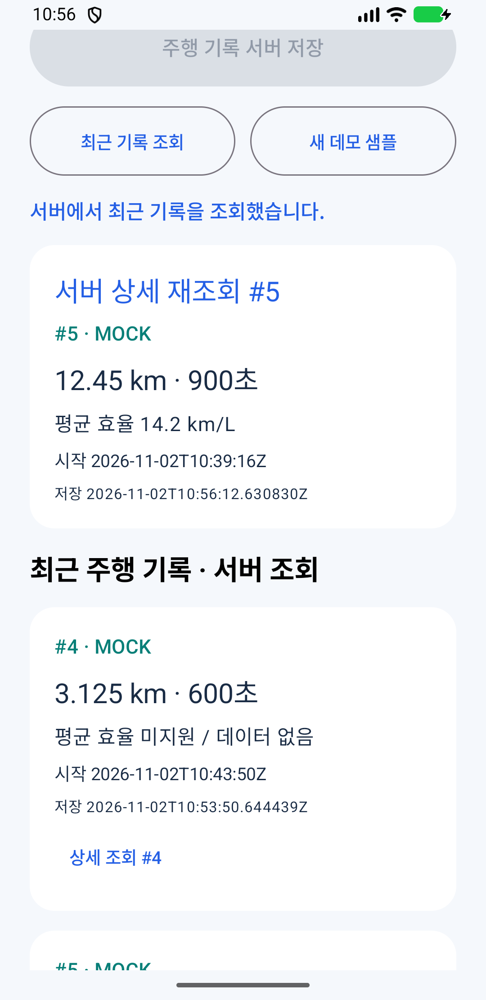

# DRIVELOG — 통합 Phase 3 구현 및 실제 검증

확인일: 2026-11-02 / Windows 11.

## 결과

일반 Android 에뮬레이터에서 MOCK 샘플을 표시하고 저장 버튼으로 Spring Boot에 POST한 뒤,
PostgreSQL에 저장된 기록을 GET 상세·목록으로 다시 받아 Compose에 표시하는 경로를 완료했다.
실제 차량 SDK 데이터 수신 성공으로 해석해서는 안 된다.

## A. 변경 파일

### Android

| 경로 | 변경 |
|---|---|
| `gradle/libs.versions.toml` | Retrofit 3.0.0 / Gson converter, Lifecycle 2.9.4, Coroutine 1.9.0 |
| `app/build.gradle.kts` | 기존 도구 버전 유지, API URL build config, Android car library, SDK별 Kotlin 소스 디렉터리 |
| `app/src/main/AndroidManifest.xml` | INTERNET, 문서로 확인한 CAR_DRIVE, optional android.car, 네트워크 보안 설정 |
| `app/src/main/res/xml/network_security_config.xml` | 기본 cleartext 차단 |
| `app/src/debug/res/xml/network_security_config.xml` | debug에서 10.0.2.2만 HTTP 허용 |
| `app/src/main/java/com/drivelog/app/MainActivity.kt` | ViewModel 연결, Activity resume 및 AAOS UX 상태에 따른 조작 제한 |
| `app/src/main/java/com/drivelog/app/feature/home/DevelopmentScreen.kt` | 서버 상태·출처·샘플·저장·목록·상세·오류 화면 |
| `app/src/main/java/com/drivelog/app/feature/home/DemoViewModel.kt` | 비동기 상태, SDK→명시적 Mock 전환, 실제 POST/GET |
| `app/src/main/java/com/drivelog/app/core/network/DriveApi.kt` | Retrofit API, BigDecimal DTO, timeout, POST 자동 재시도 없음 |
| `app/src/main/java/com/drivelog/app/core/drive/DriveDataSource.kt` | 데이터 공급자 계약·입력 모델·출처 |
| `app/src/main/java/com/drivelog/app/core/drive/MockDriveDataSource.kt` | 명시적인 가상 주행 샘플 |
| `app/src/pleos/java/com/drivelog/app/core/drive/PleosDriveDataSource.kt` | 실제 SDK 지원/서비스 확인 및 제한된 capability probe |
| `app/src/noPleos/java/com/drivelog/app/core/drive/PleosDriveDataSource.kt` | SDK 미포함 빌드의 명시적 unavailable 경로 |
| `app/src/main/java/com/drivelog/app/core/vehicle/AutomotiveUxMonitor.kt` | 표준 AAOS UX API, 확인 불가 시 조작 잠금 |

기존 Compose Theme와 단일 app 모듈을 유지했다. Root settings에 server를 포함하지 않았다.
Gson은 이미 SDK 전이 의존성에서 쓰고 있어 같은 변환 방식을 선택했다.
AGP 내장 Kotlin은 추가 Kotlin 소스를 `AndroidSourceSet.kotlin`에 지정하도록 구성했다.

### Backend

| 경로 (`server/` 기준) | 변경 |
|---|---|
| `build.gradle.kts` | springdoc 2.10.0, Flyway core / PostgreSQL 모듈 |
| `.gitignore` | `.env*` 제외 유지, `.env.example`만 예외 |
| `.env.example` | 기존 DB 자격 증명을 입력할 빈 템플릿 |
| `src/main/resources/application.yml` | validate 유지, 전용 Flyway/JPA 스키마, Swagger 공통 비활성 |
| `src/main/resources/application-local.yml` | 기존 DB placeholder 유지, local Swagger 활성 |
| `src/main/resources/db/migration/V1__create_drives.sql` | 주행 테이블·검증 제약·최근 기록 인덱스 |
| `domain/drive/controller/DriveController.java` | 생성/목록/상세 HTTP API |
| `domain/drive/controller/DriveExceptionHandler.java` | 검증·JSON·DB 제약 오류의 Problem JSON |
| `domain/drive/dto/DriveCreateRequest.java` | 필수값·시간·거리·효율·정밀도 검사 |
| `domain/drive/dto/DriveResponse.java` | Entity를 외부에 노출하지 않는 응답 |
| `domain/drive/entity/Drive.java`, `DriveSourceType.java` | 영속 모델·출처 enum |
| `domain/drive/repository/DriveRepository.java` | Spring Data JPA 접근 |
| `domain/drive/service/DriveService.java` | 쓰기/읽기 트랜잭션, DTO 변환, 정렬 |
| `src/test/.../drive/controller/DriveControllerTest.java` | HTTP 계약·검증·404·조회 제한 |
| `src/test/.../drive/DrivePostgresIntegrationTest.java` | 실제 PostgreSQL 정밀도·null·정렬·재조회 |
| `README.md` | 현재 실행·환경변수·Compose·API 문서로 갱신 |

위 domain 경로의 실제 Java 루트는 `src/main/java/com/drivelog/server/`다.
기존 `server/VERIFICATION.md`, Phase 1/2 문서는 이력으로 유지했다.
`compose.yaml`은 이미 `.env` interpolation을 지원해 변경할 필요가 없었다.

## B. API와 Swagger

| 요청 | 정상 응답 |
|---|---|
| GET `/api/v1/health` | 200, status UP / service drivelog-server |
| POST `/api/v1/drives` | 201, DriveResponse, Location 헤더 |
| GET `/api/v1/drives?limit=20` | 200, 최근 시작 시각 순 배열, limit 1~100 |
| GET `/api/v1/drives/{id}` | 200 상세, 없으면 404 |
| GET `/actuator/health` | 200 UP, 실제 DB 검사 포함 |

- Swagger UI: http://localhost:8080/swagger-ui/index.html
- OpenAPI JSON: http://localhost:8080/v3/api-docs
- Swagger HTML, JS bundle, OpenAPI JSON의 HTTP 200을 확인했다.
- OpenAPI에는 Health, Drive 생성/목록/상세가 포함된다. 브라우저의 Try it out은 같은 서버를 호출한다.
  이번 검증은 HTTP 응답과 API 호출로 진행했으며 브라우저 UI 버튼 자체를 자동화하지는 않았다.
- local 기본 활성, `-DSWAGGER_ENABLED=false`로 비활성 가능. 공통 설정 기본은 false다.
- 인증·사용자 분리가 없는 로컬 개발용이다. sourceType은 요청자의 주장으로 서버 측 차량 인증은 아니다.

POST 예시는 `server/README.md`에 있다. 시각은 offset 포함 ISO-8601, 최대 마이크로초 정밀도다.
날짜 순서와 전체 경과 초를 검증하며, 거리/효율은 NUMERIC(12,3) 범위와 일치시킨다.
거리 0 이상, 효율은 양수 또는 null이다. 효율 값·단위는 함께 존재하거나 함께 null이어야 한다.
지원 단위는 km/L, km/kWh다. 잘못된 입력/JSON/출처는 400, 미존재는 404, DB 제약 충돌은 409다.
Controller → Service → Repository 구조이며 트랜잭션은 Service가 담당한다.

## C. PostgreSQL과 저장 증거

- 기존 컨테이너: `drivelog-local-postgres-1`, PostgreSQL 17.11.
- 기존 볼륨: `drivelog-local_postgres-data`, 이름 그대로 유지.
- 시작 시 사용자 테이블이 없음을 확인했고, 전용 `drivelog` 스키마에 `drives`를 추가했다.
- `flyway_schema_history`는 관리용 보조 테이블이다. V1 성공을 SQL로 확인했다.
- `ddl-auto: validate`, `open-in-view: false`, Flyway clean 금지·자동 baseline 비활성 유지.
- 기존 계정·비밀번호 변경, 볼륨 삭제, 테이블 초기화, 기존 기록 삭제를 수행하지 않았다.

실제 DB 조회 결과:

| id | 경로 | duration_seconds | distance_km | average_efficiency | efficiency_unit | source_type |
|---|---|---:|---:|---:|---|---|
| 4 | Backend HTTP 데모 | 600 | 3.125 | null | null | MOCK |
| 5 | Android 저장 버튼 | 900 | 12.450 | 14.200 | km/L | MOCK |

두 데모 기록은 DB에 남겼다. 통합 테스트의 추가 데이터는 트랜잭션 rollback되어 남지 않는다.
시퀀스는 rollback되지 않으므로 id 1~3 등의 빈 번호는 정상이다.
서버 재시작 후에도 같은 볼륨에서 위 기록을 다시 조회했다.

`.env`는 생성하거나 덮어쓰지 않았다. `.env.example`을 기존 파일이 없을 때만 복사하고,
현재 사용 중인 DB 사용자명/비밀번호를 직접 넣으면 PowerShell 변수 없이 Compose가 읽는다.
상세 절차는 `server/README.md`를 참고한다. `.env`는 Spring이 자동으로 읽는 설정 파일이 아니다.
Spring DB·Pleos·Gemini 설정은 기존 IntelliJ VM Options 또는 안전한 OS 환경 주입 방식을 유지한다.
실제 비밀값은 문서·소스·검증 결과에 기록하지 않았다.

## D. Android End-to-End

검증 기기: 기존 `Pixel_3a_2`, API 37.1 x86_64 / 16KB 페이지 폰 이미지.
Pleos 또는 일반 AAOS AVD가 아니다.

1. SDK 포함 APK를 빌드하고 `adb install -r`로 설치했다. 앱 데이터를 초기화하지 않았다.
2. UI에서 `연결됨 · DRIVELOG UP` 및 `MOCK · 가상 데모 데이터`를 확인했다.
3. 공개 SDK의 FusedLocation 지원 확인은 false, Vehicle Service 조회는 미존재였다.
4. 실제 화면의 저장 버튼을 adb UI 좌표로 눌렀다. 별도 백엔드 POST로 대체한 것이 아니다.
5. 앱이 POST 후 GET 상세/목록을 호출해 `저장 후 서버 재조회 완료 #5`를 표시했다.
6. 별도 PostgreSQL SQL 조회의 값과 Compose `서버 상세 재조회 #5` 화면을 대조했다.
7. 최근 기록 조회 버튼도 직접 눌러 성공을 확인했다.
8. 앱 프로세스를 종료·재실행하고 새 ViewModel에서 GET한 목록에 #4/#5가 표시되는 것을 확인했다.
9. 이번 작업에서 시작한 서버 프로세스만 잠시 중지해 UI의 실제 서버 접근 실패 표시를 확인했다.
   이후 같은 DB로 서버를 재시작했고 앱의 연결/재조회 성공 상태로 복구했다.

네트워크:
- Debug: `http://10.0.2.2:8080/`, 네트워크 보안 XML에서 이 호스트만 cleartext 허용.
- Main/Release: cleartext 금지. Release API URL 기본은 빈 값으로, 배포 주소를 꾸며 넣지 않았다.
  `-PreleaseApiBaseUrl=https://<DEPLOYED_HOST>/`로 실제 HTTPS 주소를 지정해야 한다.
- Release APK에 패키징된 network-security-config의 cleartext=false도 aapt2로 확인했다.
- OkHttp에 요청/응답·비밀정보 로깅을 추가하지 않았고 POST 자동 네트워크 재시도도 끈 상태다.
- 성공한 샘플은 중복 저장 버튼을 비활성화한다. timeout 등 결과 불확실 시 재전송보다 목록 확인을 안내한다.
- Coroutine 취소는 취소로 전달하고 로딩·HTTP 실패·네트워크 실패를 UI에 표시한다.
- CORS를 네이티브 앱 때문에 일괄 허용하지 않았다. Pleos AVD의 호스트 주소 접근은 미검증이다.

주행 UX:
- distractionOptimized를 선언하지 않는다.
- AAOS에서는 표준 CarUxRestrictionsManager를 사용하며 제한 활성/확인 불가 시 조작을 숨긴다.
- Paused Activity에서는 조작 콜백을 허용하지 않는다.
- 폰 에뮬레이터는 차량 상태가 아닌 정차 데모로 취급한다.
- 실제 AAOS의 제한 전환·주행 중 차단은 AVD가 없어 런타임 미검증이다.

## E. Mock와 Pleos SDK 상태

| 항목 | 실제 검증 수준 |
|---|---|
| MockDriveDataSource | 가상 시간/거리/효율 표시 → 실제 서버·DB 저장/재조회 완료 |
| PleosDriveDataSource | 실제 SDK 코드로 지원 여부/서비스 존재를 확인하고 명시적 Mock 전환 |
| Vehicle 2.3.2 | 공식 문서 및 AAR의 public Vehicle/Odometer API 확인, 실제 Service 없음 |
| FusedLocation 1.1.3 | public API 확인 및 폰에서 isSupported() false 확인; 위치 수신은 미검증 |
| NaviHelper 3.0.5 | public 초기화/경로/정보 API 확인; Navi Service 연결·호출은 미실행 |
| 실제 PLEOS 기록 | 수신·저장 검증 없음. Android는 PLEOS 기록을 만들어 저장하지 않았다 |

다운로드한 세 SDK AAR에서 classes.jar를 추출해 javap로 공개 시그니처를 확인했다.
Vehicle의 initialize/release/getOdometer 및 checkCurrentDistanceDrivenCapabilities,
FusedLocation의 initialize/release/isSupported/getLastKnownLocation,
NaviHelper의 initialize(onConnected,onFailed), 경로/정보 API 등을 검토했다.
오도미터/트립 스냅샷만으로는 DRIVELOG의 정확한 시작·종료 경계를 보증하지 못하므로
시간·단위·효율을 임의 보충해 PLEOS 기록으로 반환하지 않는다.

현재 Pleos provider는 완전한 주행 수집기가 아니라 capability/가용성 확인 단계다.
서비스가 있는 환경에서도 완전한 세션 수집 검증이 없으면 명확한 이유와 함께 전체 Mock으로 전환한다.
부분 차량값과 Mock 필드를 혼합하지 않는다. SDK Client Secret·API 키를 Android에 넣지 않았다.

## F. 테스트 결과 및 한계

| 항목 | 결과 |
|---|---|
| Backend compileJava / bootJar | 성공 |
| Health MVC | 1 통과 |
| Drive MVC / 입력 검증 / 오류 | 12 통과 |
| 실제 PostgreSQL 통합 | 3 통과, H2 미사용 |
| Backend HTTP 생성/목록/상세/Health | 성공 |
| Swagger HTML / bundle / OpenAPI JSON | HTTP 200 |
| Android SDK 포함 assembleDebug | 성공 |
| Android SDK 제외 assembleDebug | 성공 |
| Android assembleRelease (unsigned) | 성공 |
| Android lintDebug | 0 errors / 26 warnings |
| Android 화면에서 POST/GET + DB 대조 | 성공 |
| Android 서버 장애 표시 / 복구 / 프로세스 재실행 | 성공 |
| 실제 Pleos 서비스 초기화·차량 데이터 | 서비스/AVD 없어 미검증 |
| 실제 AAOS UX 상태 전환 | 미검증 |

최초 Android 빌드에서 AGP 내장 Kotlin의 추가 소스 디렉터리 설정 오류가 발생했지만,
공식 DSL에 맞춰 수정한 최종 빌드는 모두 통과했다. 오류를 무시하는 플래그는 넣지 않았다.

기존 16KB 네이티브 정렬 경고가 남아 있다. 에뮬레이터의 호환성 안내를 OK로 닫고 검증했으며
경고를 숨기는 설정이나 바이너리 수정을 추가하지 않았다.
Lint도 전이 JNA의 libjnidispatch.so 정렬 문제를 보고한다. libuacore.so 등 SDK 측 바이너리의
16KB 지원은 공급자와 확인해야 한다. 빌드/E2E 통과가 이 문제 해결을 의미하지 않는다.
나머지 Lint 경고에는 기존 리소스 미사용 및 새 버전 안내가 포함된다.
Android instrumentation 테스트 스위트 자체는 실행하지 않았으며 UI 검증은 실제 adb 조작으로 수행했다.

로컬 상세 증거 (build 디렉터리이므로 Git 제외):
- `build/phase3/android-build.log`, `android-final-build.log`, `android-release-lint.log`, `android-sdk-free-build.log`
- `build/phase3/backend-http-result.json`, `openapi.json`, `database-result.txt`
- `build/phase3/ui-ready.xml`, `ui-after-save.xml`, `ui-server-detail.xml`, `ui-api-failure.xml`, `ui-restarted-list.xml`
- `server/build/verification/phase3-tests.log`, `phase3-server.stdout.log`
- `server/build/test-results/test/`, `server/build/test-results/integrationTest/`

최종 기본 APK는 SDK 포함 모드다. SDK 제외 검사 후 기본 모드로 다시 빌드했다.
APK: `app/build/outputs/apk/debug/app-debug.apk`.
JAR: `server/build/libs/drivelog-server-0.0.1-SNAPSHOT.jar`.

기존 PostgreSQL과 이번 검증용 서버(8080)·폰 AVD는 데모 확인이 가능하도록 실행 상태로 남겼다.
검증 서버 PID는 `server/build/verification/phase3-server.pid`에 있다.
IntelliJ로 같은 포트를 사용하려면 이 작업의 서버 프로세스인지 확인한 뒤 먼저 종료한다.
기존 Docker 서비스나 볼륨은 종료/삭제하지 않는다.

현재 루트에는 여전히 Git 메타데이터가 없어 실제 추적·커밋 상태는 확인할 수 없다.
새 Git 저장소는 만들지 않았다. `.env` 제외 규칙은 구성했지만 실제 저장소의 추적 상태 검증은 별도 필요하다.

## G. 실제 SDK 연동의 다음 조건

1. Pleos Connect API 34 전용 AVD와 Vehicle/FusedLocation/Navi 서비스를 설치·실행한다.
2. 계정에서 각 SDK의 현재 제공/사용 승인 상태를 확인한다. 문서 공개·의존성 다운로드와 사용 승인은 별개다.
3. Vehicle 연결 콜백과 각 capability·조회 권한, 실제 단위/시간 기준/서비스 버전을 확인한다.
4. 세션 시작·종료 시점의 실제 관측값으로 거리·시간을 정의하고 트립 리셋/누락/서비스 중단을 처리한다.
5. 효율을 실제 세션과 일치시켜 계산/조회할 수 없으면 null을 유지한다.
6. AAOS UX 제한 전환과 실제 차량의 HTTPS·서버 접근을 검증한 뒤 PLEOS 기록 저장을 활성화한다.
7. 배포 전 16KB 네이티브 지원·카테고리·개인정보/인증·마이그레이션 운영 정책을 별도 확정한다.

공식 출처:
- [Boot 3.5 Flyway](https://docs.spring.io/spring-boot/3.5/how-to/data-initialization.html)
- [springdoc 2.x 호환성](https://springdoc.org/v2/)
- [AGP 내장 Kotlin 소스 설정](https://developer.android.com/build/migrate-to-built-in-kotlin)
- [Retrofit 3.0.0](https://github.com/square/retrofit/releases/tag/3.0.0)
- [AAOS 정차 앱과 UX 제한](https://developer.android.com/training/cars/parked/automotive-os)
- [Vehicle 도메인/초기화](https://document.pleos.ai/docs/pleos-only/connect-sdk-pleos/Vehicle/obtain-domain-object)
- [Vehicle API](https://document.pleos.ai/docs/pleos-only/connect-sdk-pleos/Vehicle/vehicle/ai.pleos.playground.vehicle/vehicle/entry)
- [FusedLocation](https://document.pleos.ai/docs/pleos-only/connect-sdk-pleos/FusedLocation/intro)
- [NaviHelper](https://document.pleos.ai/docs/pleos-only/connect-sdk-pleos/NaviHelper/intro)
